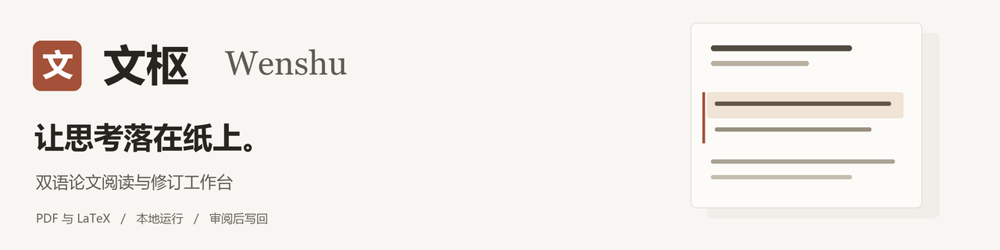
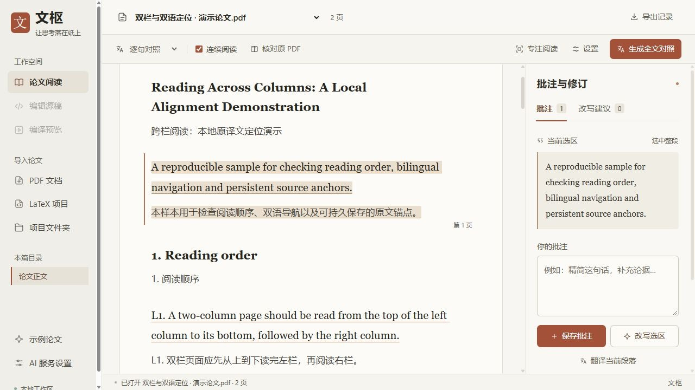
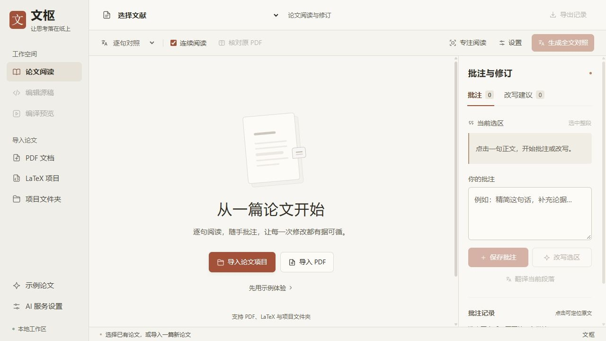

<p align="center">
  
</p>

<p align="center">
  <strong>把原文、译文、批注与改写，放在同一张工作台上。</strong>
</p>

<p align="center">
  <a href="https://github.com/feedy-hub/wenshu/releases/latest"><strong>下载 Windows 版</strong></a>
  &nbsp; · &nbsp;
  <a href="#快速开始">快速开始</a>
  &nbsp; · &nbsp;
  <a href="#从阅读到修订">使用流程</a>
  &nbsp; · &nbsp;
  <a href="#从源码运行">源码运行</a>
</p>

---

文枢是一个本地运行的双语论文工作台。导入 PDF 或 LaTeX 项目后，你可以对照阅读、选句批注、按要求生成改写建议，再核对差异并写入源稿副本。

阅读时保留原文位置，修改时保留审阅步骤，让每一次判断都有落点。

## 工作台一览



<p align="center"><sub>左侧切换论文与章节，中间对照阅读，右侧记录批注和审阅建议。截图使用内置样本，中文为人工演示译文。</sub></p>

## 你可以用它做什么

| 能力 | 在工作台中的用法 |
| :--- | :--- |
| **中英对照阅读** | 英文在上、中文在下，可选择逐句或逐段对照，也可进入专注阅读。 |
| **原页随时核对** | 结合原 PDF 检查图表、公式和正文位置，保留原始版面的参考。 |
| **选句与整段批注** | 将修改要求绑定到具体原文范围，点击批注即可返回对应位置。 |
| **有上下文的改写** | 结合选区、批注和论文上下文生成建议，或填写人工草稿查看差异。 |
| **逐项审阅与批量处理** | 对照修改前后内容，检查数字和引用；多条批注可统一生成并审阅。 |
| **LaTeX 修订闭环** | 编辑本机源稿副本、写入可定位的修改，再编译为新的 PDF。 |

工作台采用暖灰纸张底色、深色正文和陶土色标记，提供更大的界面文字与清楚的阅读层次。

## 快速开始

### Windows：下载后直接打开

1. 前往 **[最新版本下载页](https://github.com/feedy-hub/wenshu/releases/latest)**，选择 `wenshu-windows-*.zip`。
2. 完整解压后，双击 **`文枢.exe`**。
3. 浏览器会打开 **<http://127.0.0.1:18761/>**。
4. 点击 **“先用示例体验”**，或导入自己的论文。

Windows 程序已包含 Python 运行环境。只阅读 PDF、批注或使用 AI 服务，无需安装 LaTeX；编译论文源稿时，需要额外安装 TeX Live 或 TinyTeX，并将编译器加入 PATH。

<details>
<summary><strong>查看首次打开的界面</strong></summary>



</details>

### 选择合适的导入方式

| 你手上的文件 | 使用哪个入口 | 导入后可以做什么 |
| :--- | :--- | :--- |
| 一篇 PDF | **PDF 文档 / 导入 PDF** | 阅读、翻译、批注，生成及导出改写建议。 |
| 单个 `.tex` 或项目 `.zip` | **LaTeX 项目 / 导入论文项目** | 识别主文件，编译项目副本，并进行源稿修订。 |
| 包含主稿、图片和参考文献的文件夹 | **项目文件夹** | 保留项目目录结构，供编译和源稿定位使用。 |

单个 `.tex` 不会自动带入同目录的图片、参考文献或模板。有这些依赖时，建议导入完整文件夹或项目 ZIP。目录选择需要支持文件夹上传的浏览器，例如 Edge 或 Chrome。

## 从阅读到修订

1. **读到问题，选中原文。** 点击一句英文；需要完整段落时，使用“选中整段”。
2. **留下判断，保存批注。** 写下压缩、补充或澄清的要求，批注会绑定到当前原文范围。
3. **生成建议，核对差异。** 使用“改写选区”，或按多条批注批量生成；逐项检查措辞、数字、术语和引用。
4. **确认修改，写入副本。** 已关联 LaTeX 且能唯一定位的建议，可以在审阅后写入；重新编译查看结果，也可直接编辑源稿副本。

只有 PDF 时，可以导出建议供人工修改。自动写回需要关联源稿，且仅处理当前版本中能够唯一匹配的文本；复杂宏、公式或重复内容可能需要人工编辑。

## 接入你自己的 AI 服务

打开左侧 **“AI 服务设置”**，填写 API 地址、模型名称和密钥。文枢支持兼容 **OpenAI Chat Completions** 的接口。

- **没有 API 也能开始：** 阅读、批注、演示译文、人工草稿差异预览，以及已关联 LaTeX 的本地编辑与编译均可使用。
- **需要生成时再调用：** 翻译及 AI 改写会将相应正文、批注和所选上下文发送到你配置的服务。
- **密钥按运行会话保存：** API 地址和模型名保存在本机；密钥仅在当前服务进程内存中，重启后需要重新填写。

AI 输出作为待审阅的建议保存。批量任务支持停止和续跑，已经完成的建议会保留。

## 文件保存在哪里

文枢在本机保存论文、译文、批注、改写建议和源稿副本。Windows 桌面版默认使用可执行文件旁的 **`.data/`** 目录；浏览器关闭后，本地服务仍会继续运行，重复启动程序会复用现有服务。

备份或迁移工作记录时，请保留 `.data/`。GitHub 源码与下载包不包含个人工作记录。

## 从源码运行

需要 **Python 3.10+**。下载源码，或克隆仓库后安装依赖：

```sh
git clone https://github.com/feedy-hub/wenshu.git
cd wenshu
python -m venv .venv
```

**Windows**

```powershell
.\.venv\Scripts\python.exe -m pip install -r requirements.txt
.\.venv\Scripts\python.exe launch.py
```

**macOS / Linux**

```sh
.venv/bin/python -m pip install -r requirements.txt
.venv/bin/python launch.py
```

首次使用可先体验内置示例。`samples/` 还提供双栏 PDF、公式和 LaTeX 写作样本。

<details>
<summary><strong>开发检查、项目结构与桌面打包</strong></summary>

安装项目依赖后，使用环境中的 Python 运行测试；正文布局检查另需 Node.js。

```sh
python -m unittest discover -s tests -v
node tests/test_artifact_layout.cjs
node tests/test_reference_layout.cjs
```

| 目录 / 模块 | 职责 |
| :--- | :--- |
| `static/` | 阅读界面、批注、上下文和源稿编辑交互 |
| `app.py` | 本地 HTTP 服务、数据存储与 API 请求 |
| `parser.py` · `math_layout.py` | PDF 阅读顺序、图表和公式处理 |
| `writing.py` · `source_mapping.py` | 文本锚点、改写差异与源稿定位 |
| `latex_project.py` | 项目副本、编译、历史版本与写回 |
| `context_manager.py` · `batch_rewrite.py` | 论文上下文及批注批量改写 |
| `samples/` · `tests/` | 演示材料和回归测试 |

Windows 打包运行 `packaging/build_windows.ps1`；macOS 打包需在 Mac 上运行 `packaging/build_macos.sh`。打包资源不包含本机 `.data/`。当前 Releases 提供 Windows 程序与源码包。

</details>

## 当前能力边界

- **扫描 PDF 暂无 OCR。** 需要可提取的文本层，复杂版式请结合原 PDF 核对。
- **公式以保真显示为主。** 公式图片不是可直接编辑的 LaTeX 源代码。
- **批注跟随 PDF 版本。** 重新编译后，旧版本上的批注不会自动迁移到新版本。
- **自动定位保持保守。** 无法唯一匹配的范围不自动写回，仍可人工编辑或导出建议。
- **macOS 构建需在对应平台完成。** 当前没有经过本机运行验证的 macOS 独立程序，应用未签名。

## 第三方资源

前端内置 KaTeX，无需从 CDN 加载公式资源。其许可证见 [`static/vendor/katex/LICENSE`](static/vendor/katex/LICENSE)；其他依赖按各自许可证分发。

---

<p align="center"><strong>文枢 · 让思考落在纸上。</strong><br><sub>读懂一段，留下判断，再把修改落回原稿。</sub></p>
